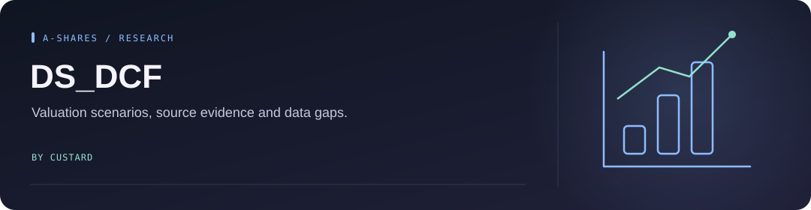
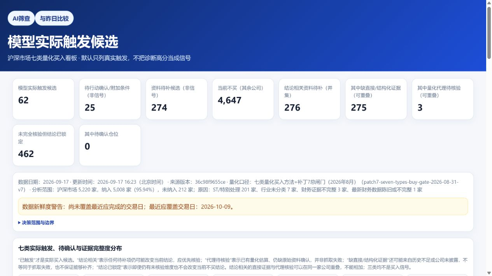

<!-- Project artwork created for this repository. -->
<p align="center">
  
</p>

<h1 align="center">DS_DCF</h1>

<p align="center">
  
</p>

**A personal research tool for comparing A-share valuations, company evidence, and screening results.**

<p align="center"><a href="#what-it-does">What it does</a> &nbsp; · &nbsp; <a href="#set-up-the-research-environment">Set up the research environment</a> &nbsp; · &nbsp; <a href="#repository-map">Repository map</a></p>

[Open the dashboard](https://quant.custard.top) · [Model](docs/MODEL.md) · [Architecture](docs/ARCHITECTURE.md) · [Operations](docs/OPERATIONS.md)


<p align="center">
  
</p>

<sub>Live dashboard, captured on 2026-10-10. This snapshot shows the current data freshness warning; it is not current market data.</sub>


## What it does

- Runs valuation scenarios and seven screening frameworks.
- Keeps source evidence, data gaps, and audit trails alongside results.
- Publishes verified market snapshots to a read-only web dashboard.

**Data status (2026-10-10):** the live dashboard currently serves the 2026-09-17 snapshot and displays a freshness warning. The last market-data publication attempt failed while fetching upstream listing data. Website deployment and data publication are separate checks.

The website is the active product. Android and desktop/Streamlit clients are retained as historical code and are no longer the main development path.

## Set up the research environment

Use Python **3.13**, matching CI. From the repository root on Windows:

```powershell
python -m venv .venv
.venv\Scripts\python.exe -m pip install --require-hashes -r requirements-bootstrap.txt
.venv\Scripts\python.exe -m pip install --require-hashes -r requirements-dev-lock.txt
.venv\Scripts\python.exe -m pip check
```

This prepares the local validation environment; it does not deploy or refresh the live dashboard. See [Operations](docs/OPERATIONS.md) for website checks and the controlled data-publication workflow.

## Repository map

| Area | Purpose |
| --- | --- |
| `engine/` | Valuation and screening rules |
| `data/` | Data providers, evidence, and snapshots |
| `cloudflare/quant-dashboard/` | Web dashboard and read-only API |
| `tools/` | Auditing and publication tools |
| `tests/` | Data, model, and release-contract checks |

For personal learning and research only, not investment advice. Public data may be delayed, incomplete, or incorrect; verify it before relying on any result.

Licensed under [PolyForm Noncommercial 1.0.0](LICENSE). Commercial use requires separate permission.
